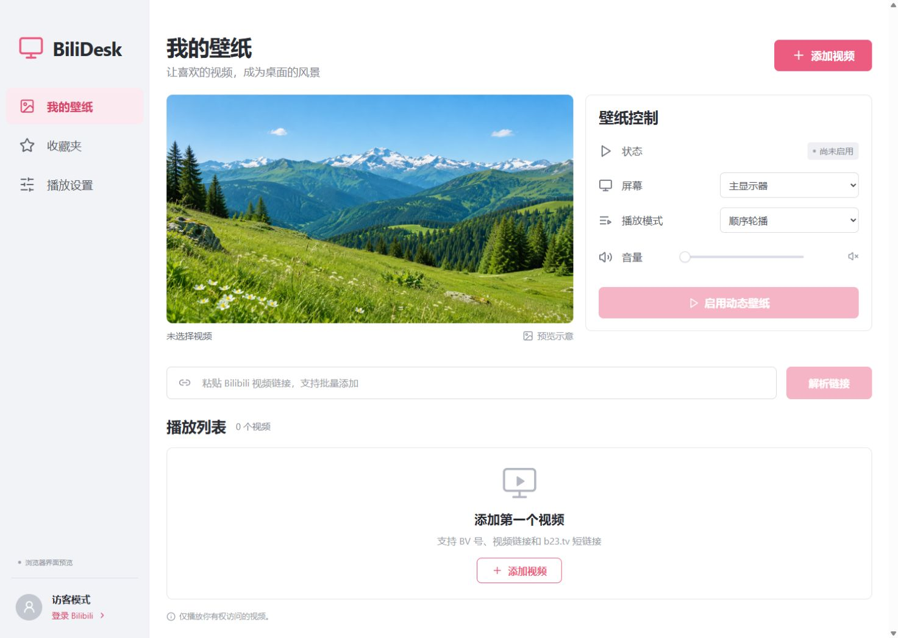
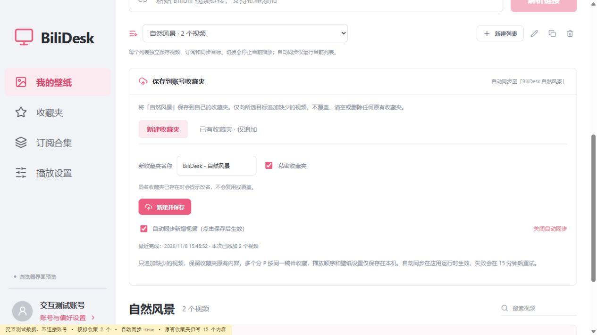
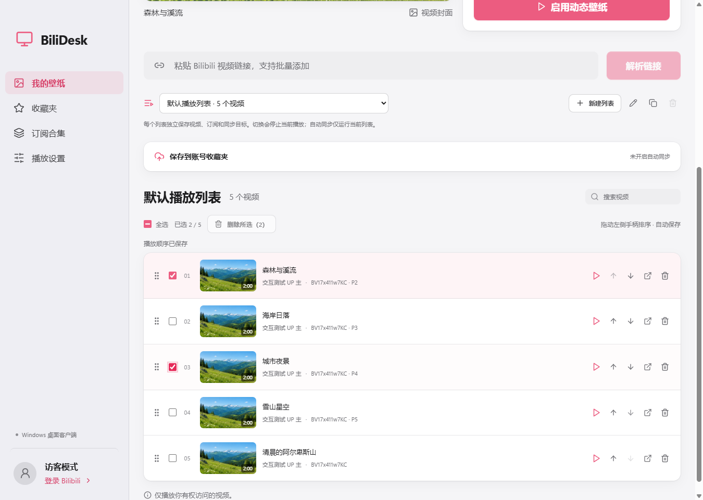
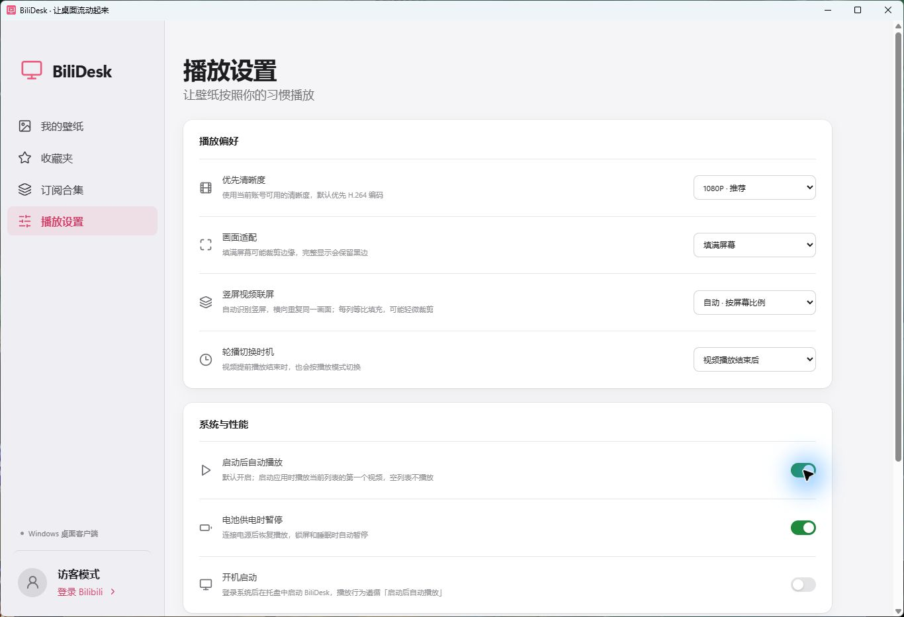

<div align="center">
  
  <h1>BiliDesk</h1>
  <p>Your favorite Bilibili videos, on your desktop.</p>
  <p><strong>English</strong> · <a href="README.zh-CN.md">简体中文</a></p>
  <p><a href="https://github.com/Cance1ed/BiliDesk/releases/tag/v0.6.2">Download preview</a> · <a href="#getting-started">Getting started</a> · <a href="https://github.com/Cance1ed/BiliDesk/issues">Report an issue</a></p>
</div>

An Electron live-wallpaper app with Bilibili playlists, favorite-folder subscriptions, collection imports, and synchronized portrait-video tiling. The current application interface is in Simplified Chinese.

<picture>
  <source media="(prefers-color-scheme: dark)" srcset="docs/screenshot-desktop-dark.png" />
  
</picture>

## Features

- **Play automatically on launch (v0.6.1):** enabled by default, including upgrades. Start the first video in the active playlist when the app opens; an empty list stays idle. Disable it in Playback settings. Starting the app at OS login remains a separate opt-in setting.

- **Anonymous playback:** BV/av IDs, video URLs, b23.tv short links, and specific video parts. Batch import, search, reorder, and deduplicate your playlist.
- **Multiple playlists:** create, rename, copy, switch, and delete up to 20 local playlists. Each keeps its own videos, subscriptions, and cloud destination. Copies start with subscriptions and cloud sync disabled.
- **Playlist editing (v0.6.2):** multi-select or select all search results, confirm batch deletion, and drag the left handle to reorder with automatic saving. Works in default and custom lists. Account favorites are never deleted; order is local. Up/down buttons remain available for keyboard use.
- **Your account:** QR login, favorite-folder browsing, and selected-video or whole-folder imports.
- **Favorite-folder subscriptions:** enter an owner's UID, profile URL, or folder URL; import existing videos and append new ones every 15 minutes, hour, 6 hours, or day. Public folders work without login.
- **Subscribed collections:** browse collections saved by your account; import entire collections or select videos across pages.
- **Save playlists to favorites:** create a new folder (private by default) or explicitly choose an existing folder for append-only saving. Same-name creation is rejected; existing folders and their contents are never replaced or deleted.
- **Portrait tiling:** automatically repeat portrait video across the desktop, typically three columns on a 16:9 display, or select 2–8 columns. All tiles share one decoded video and audio track.
- **Native-feeling interface:** a macOS-style design that follows the system light/dark appearance, with a translucent sidebar on macOS and short, interruptible motion that respects Reduce Motion, Reduce Transparency, and Increase Contrast.
- **Desktop controls:** sequential/shuffle/single looping, display selection, volume, fill/fit modes, timed switching, tray controls, lock/sleep pause, and optional battery pause.




Tiling uses actual video dimensions and preserves aspect ratio; slight cropping may be needed to fill each column. Landscape and square videos keep ordinary playback. Portrait content embedded inside a landscape video with black bars is not detected. Preview column counts follow the preview area's aspect ratio.

## Download & platform status

**[Windows x64 v0.6.2](https://github.com/Cance1ed/BiliDesk/releases/tag/v0.6.2)** · **[macOS Apple Silicon v0.6.0](https://github.com/Cance1ed/BiliDesk/releases/tag/v0.6.0)** — early previews; SHA-256 checksums are attached to each release. The original tested Windows v0.6.0 installer has also been added to its [release](https://github.com/Cance1ed/BiliDesk/releases/tag/v0.6.0). The published Mac v0.6.0 binary does not include launch autoplay or the new playlist editing controls. Shared v0.6.2 source includes both, but has not yet been built or tested on Mac.

| Platform                                    | Status                                                                                                                                       |
| ------------------------------------------- | -------------------------------------------------------------------------------------------------------------------------------------------- |
| macOS Apple Silicon                         | v0.6.0 DMG built and tested: desktop layering below Finder icons, playback, portrait tiling, subscriptions                                   |
| Windows 11 x64                              | v0.6.2 installer built and tested: batch deletion, drag sorting, persistence, autoplay, playback, desktop coverage, tiling and subscriptions |
| macOS Intel                                 | Not built or tested                                                                                                                          |
| Windows 10 / mixed-DPI multi-monitor setups | Not fully validated                                                                                                                          |

Installers are unsigned, and the macOS app is not notarized. On first launch macOS reports that it cannot verify the app: open **System Settings → Privacy & Security**, click **Open Anyway** next to BiliDesk, and confirm. Exit the previous version from the tray before upgrading; local configuration is retained.

**Windows verification (2026-11-10):** v0.6.2 passed all 51 offline tests and the production/NSIS build. The final packaged app passed public subscription import (28 videos), real playback, full 2560×1440 coverage, portrait tiling and all three startup scenarios. UI checks against the final packaged code verified pointer dragging in both directions, batch deletion/cancellation, filtered selection, independent custom lists and restart persistence at 1366×1000 and 940×700. Installer executable and app archive hashes match the tested payload. See [verification details and limits](docs/verification.md).

## Getting started

1. In **我的壁纸 (My wallpapers)**, select a playlist or use **新建列表 (New playlist)**. Paste a link or BV/av ID and click **解析链接 (Parse link)** to add to the selected list.
2. Select a video and click **启用动态壁纸 (Enable live wallpaper)**. Playback is muted by default.
3. Open **收藏夹 → 订阅收藏夹 (Favorites → Subscribe)** to subscribe to a particular user's folder. Log in to access private folders when permitted.
4. Open **订阅合集 (Subscribed collections)** after login to import whole collections or selected videos.
5. Expand **保存到账号收藏夹 (Save to account favorites)**. Use **新建收藏夹 (New folder)** and **新建并保存 (Create and save)**, or choose **已有收藏夹 · 仅追加 (Existing folder · append only)**. Automatic account writes are off until explicitly enabled and saved.
6. Use **播放设置 → 竖屏视频联屏 (Playback settings → Portrait tiling)** for automatic, fixed-column, or disabled tiling.

Closing the management window keeps the app in the tray. Pause, skip, stop, or quit from the tray; stop/quit restores the underlying desktop.

### Select, delete and reorder videos

In the default or any custom playlist, tick the boxes beside videos, then choose **删除所选 (Delete selected)** and confirm. **全选 (Select all)** applies to the current search results; changing the search or switching lists clears selection. Deletion affects only the current local list. Deleting the currently playing item stops the wallpaper; account favorites are preserved.

Drag the six-dot handle to the upper/lower half of a target row to insert before/after it. The insertion line shows the destination. Order saves automatically and is used by sequential playback after restarting, without interrupting the current video. Up/down buttons remain available for keyboard operation. Account favorite order is unchanged.



### Automatic playback on launch

Since v0.6.1, **播放设置 → 系统与性能 → 启动后自动播放** is on by default. On each app launch, the first video in the saved active playlist starts automatically using the saved playback settings. An empty list stays idle; adding its first video still requires **启用动态壁纸**. Disable the switch to keep startup manual; this choice persists. Manual stop and playlist switching do not trigger autoplay again during the same session. Existing battery, lock and sleep pause behavior remains in effect.

**开机启动 (Launch at login)** remains off by default. If explicitly enabled, it starts the tray app at login and follows the separate autoplay setting. Playback does not resume at the previous timestamp.



### Synchronization rules

- Up to 20 playlists, each with 20 subscriptions and 1,000 entries. Switching stops current playback and cancels the old list's pending sync; only the active list syncs automatically while the app runs. Already submitted requests may finish.
- Upgrades migrate the old list to **默认播放列表 (Default playlist)** and save the original JSON as `library.before-multi-playlists.json` before the first write. Renaming/deleting a local list never renames/deletes an account folder. Global playback settings remain shared.
- Folder subscriptions append new videos. Unsubscribing keeps imports; manually removed videos are not re-added by that subscription. Re-subscribing starts a fresh import.
- Account synchronization is **additive**, not a two-way mirror: it never deletes existing favorites. New entries are scheduled after about 5 seconds; a 15-minute check retries failures.
- Bilibili favorites store whole submissions: multiple parts of one video are favorited once. Part selection, ordering, and wallpaper settings remain local.
- Logout disables account synchronization. A different account must select its own destination. Already submitted requests may finish after cancellation.

## Development

Requires **Node.js 24** and npm. Electron is downloaded during dependency installation.

```sh
git clone https://github.com/Cance1ed/BiliDesk.git
cd BiliDesk
npm ci
npm run dev
```

```sh
npm test                 # Offline regression tests
npm run build            # TypeScript + Vite production build
npm run test:smoke       # Isolated Electron / preload check
npm run dist:win         # Windows x64 NSIS installer
npm run dist:mac         # Build on a Mac for its native CPU architecture
npm run licenses         # Refresh installed production dependency notices
```

`npm run dev:web` provides a UI-only preview; browsers cannot log in, resolve media, or attach to the system desktop. Build Mac architectures separately with matching native dependencies.

Optional integration checks:

```sh
npm run test:live
npm run test:playback
node scripts/smoke.mjs --packaged --playback --portrait
node scripts/smoke.mjs --packaged --startup=enabled
node scripts/smoke.mjs --packaged --startup=disabled
node scripts/smoke.mjs --packaged --startup=empty
```

Live/playback checks use public Bilibili content and isolated temporary data. Playback tests temporarily attach a wallpaper and restore the desktop afterward. Portrait tests use original local synthetic videos. Run packaged checks from the repository root after building a package; set `BILIDESK_RELEASE_DIR` if the build output is not in `release/`. On macOS the playback check also asserts the wallpaper sits between the desktop and its icons.

See [verification notes](docs/verification.md), the [detailed Chinese guide](docs/guide.zh-CN.md), and the desktop build configuration under `.github` for more information.

**CI is not active yet.** The build configuration is provided as a [workflow template](.github/workflow-templates/README.md); the publishing credential did not have GitHub's `workflow` scope. Local builds work independently of GitHub Actions.

## Privacy & limitations

- Cookies stay in Electron's main process and are encrypted by the OS through `safeStorage`. If encryption is unavailable, login lasts only for the current session.
- Data locations: Windows `%APPDATA%/BiliDesk`; macOS `~/Library/Application Support/BiliDesk`. `library.json` contains playlists, settings, subscriptions, and sync targets; `account.enc` contains encrypted credentials.
- Bilibili web APIs may change or restrict requests. Private, paid, regional, and membership-only content remains subject to account permissions; access controls are not bypassed.
- Public APIs, playback, and tiling were tested on Windows 11 and macOS (Apple Silicon). **Real-account QR confirmation, private/VIP content, and favorite writes still require account acceptance testing.** Writes have been tested with simulated transport, not a personal account.
- One selected display is supported at a time. Offline caching, live streams, bangumi links, HDR/HEVC, and pause for foreground full-screen apps are not included.
- The Alpine preview is AI-generated illustrative artwork, not a preloaded Bilibili video. Fixture screenshots/videos are labeled synthetic.

## License & credits

**[Apache License 2.0](LICENSE)** permits use, modification, and distribution, including commercial use, subject to its terms, and includes an express contributor patent grant. Dependencies retain their own licenses; see [NOTICE](NOTICE) and [third-party notices](THIRD_PARTY_NOTICES.txt). Electron/Chromium notices ship with the packaged runtime.

Built with Electron, React, TypeScript, Vite, Koffi, Lucide, and node-qrcode. API research references the [community Bilibili API documentation](https://github.com/bilibili-plugins/bilibili-api-collect). BiliDesk is independent and is not affiliated with or endorsed by Bilibili. Only play content you are authorized to access and use.
