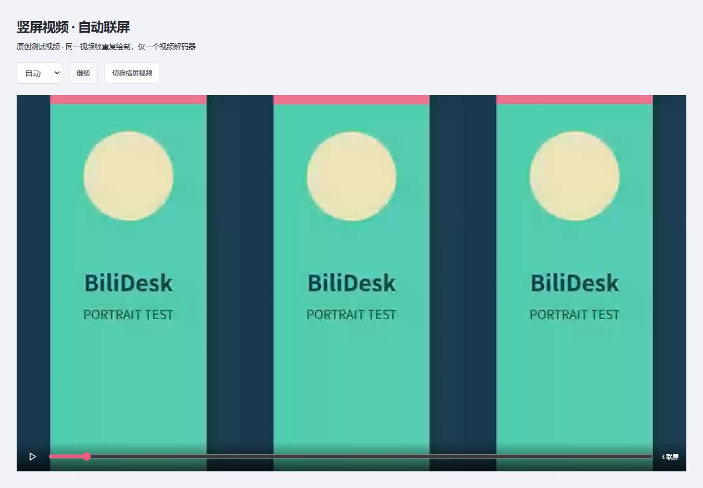

<div align="center">
  
  <h1>BiliDesk</h1>
  <p>Your favorite Bilibili videos, on your desktop.</p>
  <p><strong>English</strong> · <a href="README.zh-CN.md">简体中文</a></p>
  <p><a href="https://github.com/Cance1ed/BiliDesk/releases/tag/v0.4.0">Download preview</a> · <a href="#getting-started">Getting started</a> · <a href="https://github.com/Cance1ed/BiliDesk/issues">Report an issue</a></p>
</div>

An Electron live-wallpaper app with Bilibili playlists, favorite-folder subscriptions, collection imports, and synchronized portrait-video tiling. The current application interface is in Simplified Chinese.


## Features

- **Anonymous playback:** BV/av IDs, video URLs, b23.tv short links, and specific video parts. Batch import, search, reorder, and deduplicate your playlist.
- **Your account:** QR login, favorite-folder browsing, and selected-video or whole-folder imports.
- **Favorite-folder subscriptions:** enter an owner's UID, profile URL, or folder URL; import existing videos and append new ones every 15 minutes, hour, 6 hours, or day. Public folders work without login.
- **Subscribed collections:** browse collections saved by your account; import entire collections or select videos across pages.
- **Save playlists to favorites:** choose your own account's destination folder and optionally enable automatic synchronization. Missing videos are appended; existing favorites are preserved.
- **Portrait tiling:** automatically repeat portrait video across the desktop, typically three columns on a 16:9 display, or select 2–8 columns. All tiles share one decoded video and audio track.
- **Desktop controls:** sequential/shuffle/single looping, display selection, volume, fill/fit modes, timed switching, tray controls, lock/sleep pause, and optional battery pause.



Tiling uses actual video dimensions and preserves aspect ratio; slight cropping may be needed to fill each column. Landscape and square videos keep ordinary playback. Portrait content embedded inside a landscape video with black bars is not detected. Preview column counts follow the preview area's aspect ratio.

## Download & platform status

**[Download Windows x64 v0.4.0](https://github.com/Cance1ed/BiliDesk/releases/tag/v0.4.0)** — early preview; SHA-256 checksums are attached to the release.

| Platform                                    | Status                                                                                 |
| ------------------------------------------- | -------------------------------------------------------------------------------------- |
| Windows 11 x64                              | Installer built; native attachment, playback, full desktop coverage, and tiling tested |
| Windows 10 / mixed-DPI multi-monitor setups | Not fully validated                                                                    |
| macOS Apple Silicon / Intel                 | Adapter and build configuration included; no verified Mac release yet                  |

Installers are unsigned. macOS signing and notarization are not configured. Exit the previous version from the tray before upgrading; local configuration is retained.

## Getting started

1. In **我的壁纸 (My wallpapers)**, paste a link or BV/av ID and click **解析链接 (Parse link)**.
2. Select a video and click **启用动态壁纸 (Enable live wallpaper)**. Playback is muted by default.
3. Open **收藏夹 → 订阅收藏夹 (Favorites → Subscribe)** to subscribe to a particular user's folder. Log in to access private folders when permitted.
4. Open **订阅合集 (Subscribed collections)** after login to import whole collections or selected videos.
5. Expand **保存到账号收藏夹 (Save to account favorites)** above the playlist, choose a destination, and click **保存并同步 (Save and sync)**. Automatic account writes are off until explicitly enabled and saved.
6. Use **播放设置 → 竖屏视频联屏 (Playback settings → Portrait tiling)** for automatic, fixed-column, or disabled tiling.

Closing the management window keeps the app in the tray. Pause, skip, stop, or quit from the tray; stop/quit restores the underlying desktop.

### Synchronization rules

- Synchronization runs only while the app is running. Up to 20 folder subscriptions and 1,000 playlist entries are supported.
- Folder subscriptions append new videos. Unsubscribing keeps imports; manually removed videos are not re-added by that subscription. Re-subscribing starts a fresh import.
- Account synchronization is **additive**, not a two-way mirror: it never deletes existing favorites. New entries are scheduled after about 5 seconds; a 15-minute check retries failures.
- Bilibili favorites store whole submissions: multiple parts of one video are favorited once. Part selection, ordering, and wallpaper settings remain local.
- Logout disables account synchronization. A different account must select its own destination. Already submitted requests may finish after cancellation.

## Development

Requires **Node.js 24** and npm. Electron is downloaded during dependency installation.

```sh
git clone https://github.com/Cance1ed/BiliDesk.git
cd BiliDesk
npm ci
npm run dev
```

```sh
npm test                 # Offline regression tests
npm run build            # TypeScript + Vite production build
npm run test:smoke       # Isolated Electron / preload check
npm run dist:win         # Windows x64 NSIS installer
npm run dist:mac         # Build on a Mac for its native CPU architecture
npm run licenses         # Refresh installed production dependency notices
```

`npm run dev:web` provides a UI-only preview; browsers cannot log in, resolve media, or attach to the system desktop. Build Mac architectures separately with matching native dependencies.

Optional integration checks:

```sh
npm run test:live
npm run test:playback
node scripts/smoke.mjs --packaged --playback --portrait
```

Live/playback checks use public Bilibili content and isolated temporary data. Playback tests temporarily attach a wallpaper and restore the desktop afterward. Portrait tests use original local synthetic videos. Run packaged checks from the repository root after building the Windows package.

See [verification notes](docs/verification.md), the [detailed Chinese guide](docs/guide.zh-CN.md), and the desktop build configuration under `.github` for more information.

**CI is not active yet.** The build configuration is provided as a [workflow template](.github/workflow-templates/README.md); the publishing credential did not have GitHub's `workflow` scope. Local builds work independently of GitHub Actions.

## Privacy & limitations

- Cookies stay in Electron's main process and are encrypted by the OS through `safeStorage`. If encryption is unavailable, login lasts only for the current session.
- Data locations: Windows `%APPDATA%/BiliDesk`; macOS `~/Library/Application Support/BiliDesk`. `library.json` contains playlists, settings, subscriptions, and sync targets; `account.enc` contains encrypted credentials.
- Bilibili web APIs may change or restrict requests. Private, paid, regional, and membership-only content remains subject to account permissions; access controls are not bypassed.
- Public APIs, Windows playback, and tiling were tested. **Real-account QR confirmation, private/VIP content, and favorite writes still require account acceptance testing.** Writes have been tested with simulated transport, not a personal account.
- One selected display is supported at a time. Offline caching, live streams, bangumi links, HDR/HEVC, and pause for foreground full-screen apps are not included.
- The Alpine preview is AI-generated illustrative artwork, not a preloaded Bilibili video. Fixture screenshots/videos are labeled synthetic.

## License & credits

**[Apache License 2.0](LICENSE)** permits use, modification, and distribution, including commercial use, subject to its terms, and includes an express contributor patent grant. Dependencies retain their own licenses; see [NOTICE](NOTICE) and [third-party notices](THIRD_PARTY_NOTICES.txt). Electron/Chromium notices ship with the packaged runtime.

Built with Electron, React, TypeScript, Vite, Koffi, Lucide, and node-qrcode. API research references the [community Bilibili API documentation](https://github.com/bilibili-plugins/bilibili-api-collect). BiliDesk is independent and is not affiliated with or endorsed by Bilibili. Only play content you are authorized to access and use.
