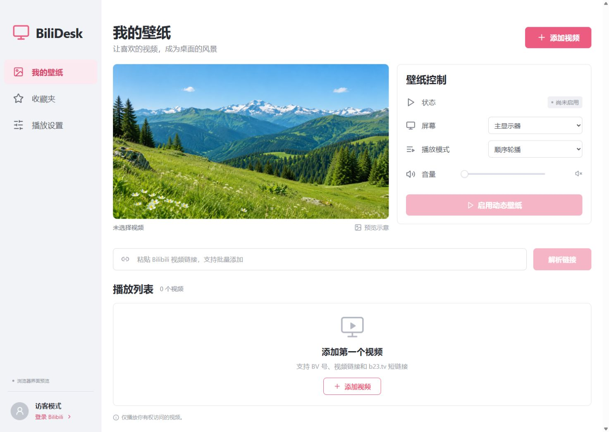
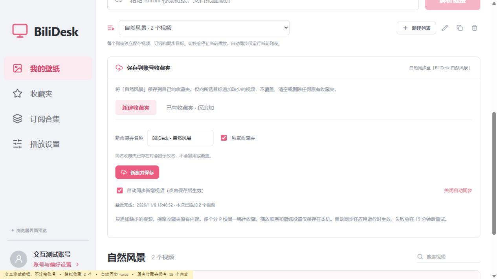
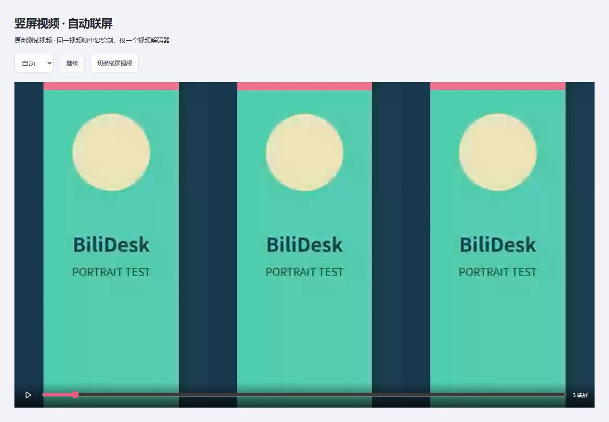
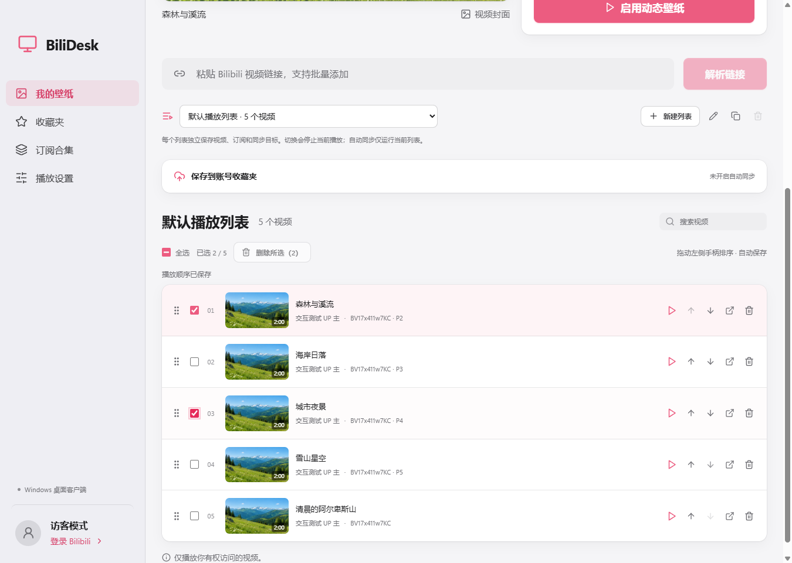
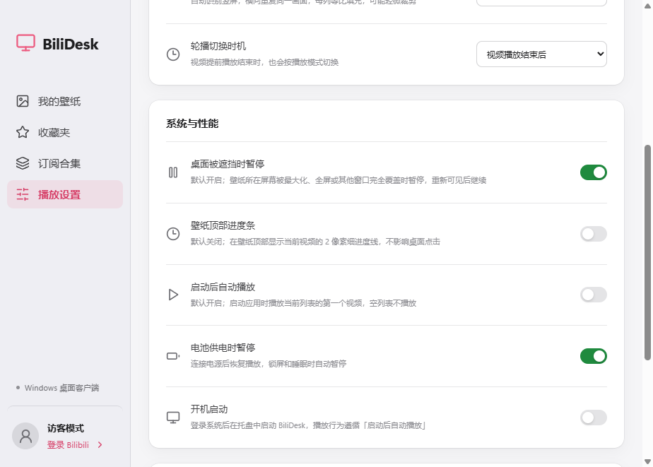
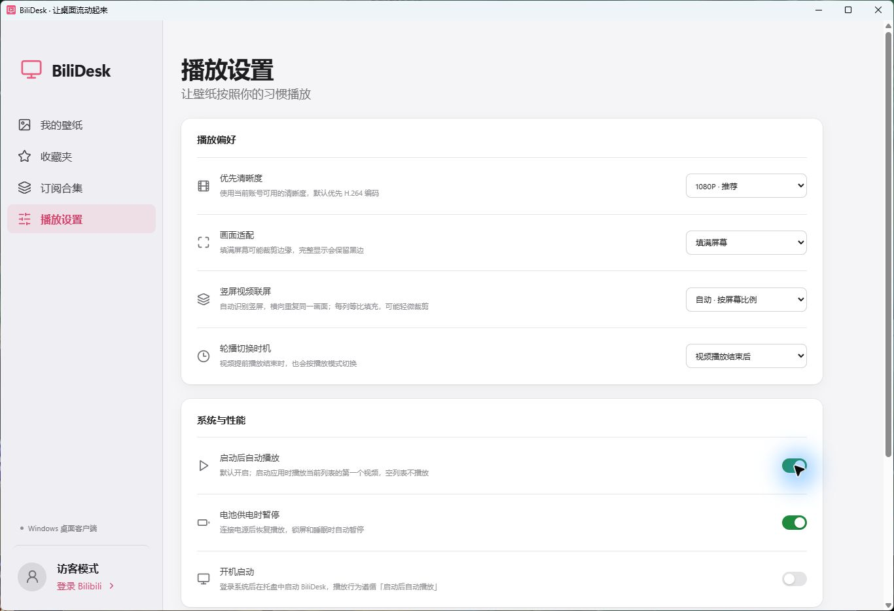

<div align="center">
  
  <h1>BiliDesk</h1>
  <p>让喜欢的 Bilibili 视频，成为桌面的风景。</p>
  <p><a href="README.md">English</a> · <strong>简体中文</strong></p>
  <p><a href="https://github.com/Cance1ed/BiliDesk/releases/tag/v0.6.3">下载预览版</a> · <a href="#快速开始">快速开始</a> · <a href="https://github.com/Cance1ed/BiliDesk/issues">反馈问题</a></p>
</div>

基于 Electron 的动态壁纸应用，支持 Bilibili 播放列表、收藏夹订阅、合集导入和同步竖屏三联 / N 联效果。当前应用界面为简体中文。

<picture>
  <source media="(prefers-color-scheme: dark)" srcset="docs/screenshot-desktop-dark.png" />
  
</picture>

## 功能

- **启动后自动播放（v0.6.1）**：默认开启，旧配置升级后也默认开启；打开应用即播放当前列表的第一个视频，空列表保持待机，可在播放设置中关闭。「开机启动」仍需单独手动开启。

- **匿名播放**：BV / av 号、视频 URL、b23.tv 短链、指定分 P，支持批量添加、搜索、排序、去重。
- **多个自定义播放列表**：最多 20 个，支持新建、重命名、复制、切换和删除；各自保存视频、订阅及云端同步目标，复制时不继承订阅和账号同步。
- **播放列表编辑（v0.6.2）**：默认列表和自定义列表均支持多选、全选搜索结果、确认后批量删除；拖动左侧手柄调整顺序并自动保存，也保留可用键盘操作的上下移动按钮。删除只影响本地条目，账号收藏夹保持不变；顺序仅在本地保存。
- **登录自己的账号**：扫码登录，浏览收藏夹，导入整个收藏夹或选中的视频。
- **订阅指定用户的收藏夹**：输入 UID、主页或收藏夹链接，首次导入现有视频，再按每 15 分钟、每小时、每 6 小时或每天追加新视频；公开收藏夹可匿名读取。
- **订阅合集**：读取账号收藏 / 订阅的合集，整合集导入或跨页勾选部分视频。
- **保存到账号收藏夹**：可以新建收藏夹（默认私密），或明确选择已有收藏夹追加保存；同名新建会被拦截，不复用、覆盖或删除已有收藏夹及其内容。
- **竖屏自动联屏**：普通 16:9 屏幕上自动三联，也可指定 2～8 联；各列共用一个视频解码器和一份声音。
- **原生质感界面**：macOS 风格设计，跟随系统浅色 / 深色外观；macOS 上侧栏为半透明材质；动效短促、可随时打断，并遵循「减弱动态效果」「降低透明度」「增强对比度」设置。
- **桌面控制**：顺序 / 随机 / 单曲循环，屏幕选择、音量、画面适配、定时切换、托盘控制、锁屏 / 睡眠暂停、可选电池暂停。
- **遮挡暂停与顶部进度线（v0.6.3）**：默认在最大化、全屏或多个窗口完全覆盖壁纸所在屏幕的工作区域时暂停，重新可见后从原进度继续；保留手动暂停。可选顶部 2 像素细进度线，默认关闭。两个开关位于「播放设置 → 系统与性能」。已实测 Windows，macOS 实现待实机验证。





联屏根据视频实际宽高识别竖屏，各列等比填满，可能轻微裁剪。横屏和正方形视频保持普通显示；嵌在横屏黑边画布里的竖屏内容不会自动识别。预览的自动列数按预览区域比例计算。

## 下载与平台状态

**[Windows x64 v0.6.3](https://github.com/Cance1ed/BiliDesk/releases/tag/v0.6.3)** · **[macOS（Apple 芯片）v0.6.0](https://github.com/Cance1ed/BiliDesk/releases/tag/v0.6.0)**：早期预览版，各 Release 均附 SHA-256 校验文件。原始测试通过的 Windows v0.6.0 安装包也已补充至[对应 Release](https://github.com/Cance1ed/BiliDesk/releases/tag/v0.6.0)。已发布的 Mac v0.6.0 包不含启动自动播放、新增列表编辑、遮挡暂停和顶部进度线；共享的 v0.6.3 源码已包含这些功能，但尚未在 Mac 上重新构建和验证。

| 平台                      | 状态                                                                                       |
| ------------------------- | ------------------------------------------------------------------------------------------ |
| macOS Apple 芯片          | v0.6.0 DMG 已构建并实测：壁纸位于桌面图标之下、播放、竖屏联屏、收藏夹订阅                  |
| Windows 11 x64            | v0.6.3 安装包已构建并实测：遮挡暂停 / 恢复、顶部进度线、设置保存、列表编辑、自动播放与联屏 |
| macOS Intel               | 尚未构建和测试                                                                             |
| Windows 10 / 多屏混合 DPI | 尚未完整验证                                                                               |

安装包未签名，macOS 版未经公证。首次打开时 macOS 会提示无法验证该 App：前往「系统设置 → 隐私与安全性」，在 BiliDesk 旁点「仍要打开」并确认。升级前从托盘退出旧版，本机配置会保留。

**Windows 验证（2026-11-10）**：v0.6.3 通过 56 项离线测试及生产 / NSIS 构建。最终打包程序通过原生最大化 / 全屏暂停、原进度恢复、手动暂停和组合条件保护，以及进度线尺寸、冻结、重置、联屏和关闭检查。两个开关在最终打包代码的 1366×1000、940×700 界面验证通过，重启后保留选择；公开订阅导入（28 个视频）、真实播放、2560×1440 全覆盖、竖屏联屏和三种启动场景均通过。安装包内程序及归档哈希与测试产物一致。详见[验证记录及边界](docs/verification.md)。

## 快速开始

1. 在「我的壁纸」选择播放列表，或点「新建列表」自定义名称。粘贴链接或 BV / av 号并点击「解析链接」，视频会加入当前列表。
2. 选中视频，点击「启用动态壁纸」，默认静音。
3. 在「收藏夹 → 订阅收藏夹」添加指定用户的收藏夹；登录后可在权限范围内读取私有收藏夹。
4. 登录后进入「订阅合集」，导入整个合集或勾选视频。
5. 展开「保存到账号收藏夹」，选择「新建收藏夹 → 新建并保存」，或选择「已有收藏夹 · 仅追加 → 追加保存并同步」。账号自动写入默认关闭，需勾选后保存才会开启。
6. 在「播放设置 → 竖屏视频联屏」选择自动、固定列数或关闭。

关闭管理窗口后应用保留在托盘，可暂停、下一首、停止或退出；停止 / 退出恢复底层桌面。

### 多选删除与拖动排序

默认列表和自定义列表的每行左侧均可勾选，选择后点击「删除所选」并确认。搜索时「全选搜索结果」只选择当前结果；修改搜索词、切换列表会清空选择。删除只移除当前本地列表的条目，账号收藏夹保持不变；删除当前播放项会停止壁纸。

按住左侧六点手柄，拖到目标行上半部或下半部，按插入线提示放到之前或之后。顺序自动保存，重启后保留，顺序轮播会使用此顺序；拖动本身不打断当前播放。也可通过上下移动按钮使用键盘排序，账号收藏夹顺序不变。



### 遮挡暂停与顶部进度条

在「播放设置 → 系统与性能」中设置：

- **桌面被遮挡时暂停**默认开启，旧配置升级后也开启。约每秒检查壁纸所在屏幕，最大化、全屏或多个窗口覆盖整个工作区域时暂停；部分遮挡、其他屏幕窗口不触发。重新可见后从原进度继续，并保留手动暂停 / 停止及其他系统暂停条件。睡眠唤醒仍沿用重新取流策略。
- **壁纸顶部进度条**默认关闭。开启后显示 2 像素细线，暂停时冻结、换视频归零，竖屏联屏只显示一条；不拦截桌面点击，不提供拖动跳转。

检测只使用窗口状态、范围与透明度，不读取窗口标题或截图；透明 / 异形窗口不逐像素判断。多显示器混合 DPI、独占全屏游戏及虚拟桌面切换仍待实机验证。



### 启动后自动播放

自 v0.6.1 起，「播放设置 → 系统与性能 → 启动后自动播放」默认开启。每次启动应用时，从上次保存的当前列表第一个视频开始，沿用已保存的播放设置。空列表不会报错；首次添加视频后仍需点击「启用动态壁纸」。关闭开关后会记住选择，下次启动保持待机；同一次运行中手动停止、切换列表不会再次触发自动播放。已有电池、锁屏和睡眠暂停机制继续生效。

「开机启动」仍默认关闭；手动开启后，登录系统会启动托盘程序，再按「启动后自动播放」决定是否播放。不会恢复上次播放的时间点。



### 同步规则

- 最多 20 个播放列表，每个列表最多 20 个订阅、1,000 个视频。切换列表会停止播放及旧列表的待处理同步；应用运行时只自动同步当前列表，已经提交的请求可能完成。
- 升级会将旧列表迁移为「默认播放列表」，首次写入前将原文件备份为 `library.before-multi-playlists.json`。重命名或删除本地列表不修改账号收藏夹，播放设置仍为全局共享。
- 订阅只追加新视频；取消订阅保留已导入内容。手动移除的视频不会被同一订阅重新添加，取消后重新订阅则重新导入。
- 账号同步为**追加保存**，不是双向镜像，不删除原有收藏。新增视频约 5 秒后安排同步，每 15 分钟复查或重试。
- Bilibili 按稿件收藏，同一视频的多个分 P 只收藏一次；分 P 选择、顺序和壁纸设置保存在本机。
- 退出登录关闭账号同步，换账号需重新选择目标；停止时已经提交的请求可能完成。

## 本地开发

需要 **Node.js 24** 和 npm，安装依赖时下载 Electron。

```sh
git clone https://github.com/Cance1ed/BiliDesk.git
cd BiliDesk
npm ci
npm run dev
```

```sh
npm test                 # 离线回归测试
npm run build            # TypeScript 检查 + Vite 生产构建
npm run test:smoke       # 隔离数据的 Electron / preload 检查
npm run dist:win         # Windows x64 NSIS 安装包
npm run dist:mac         # 在 Mac 上构建本机 CPU 架构安装包
npm run licenses         # 更新已安装的生产依赖许可声明
```

`npm run dev:web` 仅预览界面，浏览器不能登录、解析媒体或挂载系统桌面。Mac 两种架构应分别安装对应原生依赖。

可选集成测试：

```sh
npm run test:live
npm run test:playback
node scripts/smoke.mjs --packaged --playback --portrait
node scripts/smoke.mjs --packaged --startup=enabled
node scripts/smoke.mjs --packaged --startup=disabled
node scripts/smoke.mjs --packaged --startup=empty
node scripts/smoke.mjs --packaged --visibility # Windows 原生遮挡 / 进度条回归
```

联网 / 播放测试使用公开 Bilibili 内容及隔离临时数据，会短暂挂载壁纸并在结束后恢复桌面。竖屏测试使用原创本地合成视频。打包测试需先构建安装包，并从仓库根目录执行；构建输出不在 `release/` 时设置 `BILIDESK_RELEASE_DIR`。在 macOS 上，播放测试还会检查壁纸窗口位于桌面与桌面图标之间。

更多信息见[验证记录](docs/verification.md)、[详细使用说明](docs/guide.zh-CN.md)及 `.github` 下的桌面构建配置。

**CI 暂未启用。** 当前发布凭据没有 GitHub `workflow` 权限，构建配置以[工作流模板](.github/workflow-templates/README.md)提供，可在取得相应权限后启用；本机构建不依赖 GitHub Actions。

## 隐私与限制

- Cookie 留在 Electron 主进程，通过 `safeStorage` 使用系统加密；系统加密不可用时只保留当次登录。
- 数据目录：Windows `%APPDATA%/BiliDesk`；macOS `~/Library/Application Support/BiliDesk`。`library.json` 保存列表、设置、订阅与同步目标；`account.enc` 保存加密凭据。
- Bilibili 网页接口可能变更或限制请求；私有、付费、地区限制和会员内容仍受账号权限约束，应用不绕过访问控制。
- 已在 Windows 11 和 macOS（Apple 芯片）上验证公开接口、播放及联屏。**真实账号扫码确认、私有 / VIP 内容及收藏写入仍需账号验收**；收藏写入使用模拟传输测试，尚未使用个人账号实测。
- 一次支持一个所选显示器，不包含离线缓存、直播、番剧、HDR / HEVC、前台全屏应用自动暂停。
- 阿尔卑斯山预览是 AI 生成的示意素材，不是预置 Bilibili 视频。测试截图及测试片已标注为合成数据。

## 许可证与致谢

采用 **[Apache License 2.0](LICENSE)**。遵守条款即可使用、修改、分发和商用，并包含明确的贡献者专利授权。第三方依赖保留各自许可证，详见 [NOTICE](NOTICE) 与[第三方许可声明](THIRD_PARTY_NOTICES.txt)；Electron / Chromium 声明随运行时打包。

使用 Electron、React、TypeScript、Vite、Koffi、Lucide 和 node-qrcode 构建，接口研究参考[社区 Bilibili API 文档](https://github.com/bilibili-plugins/bilibili-api-collect)。BiliDesk 是独立项目，与 Bilibili 官方无隶属或背书关系。请仅播放你有权访问和使用的内容。
