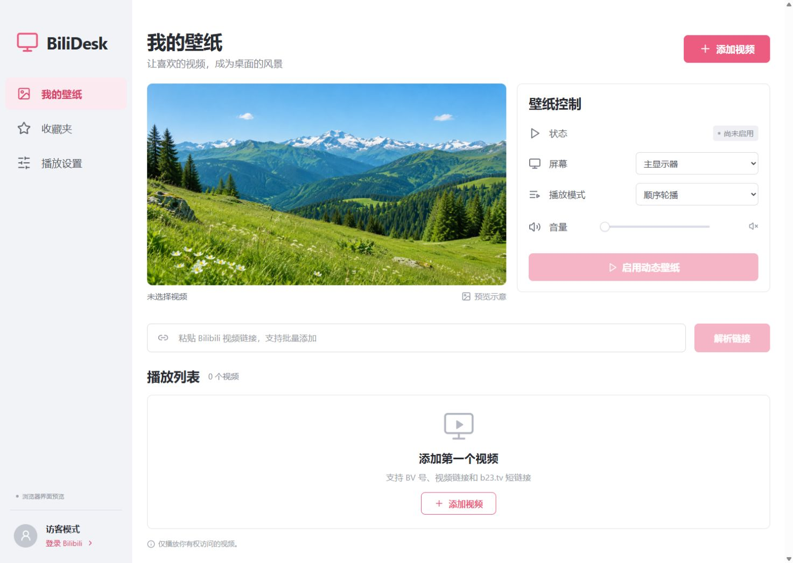

# BiliDesk

把 Bilibili 视频放到 Windows / macOS 桌面上。Electron + React + TypeScript，独立壁纸播放器，默认静音。



## 使用

macOS（Apple 芯片）：`release/BiliDesk-0.6.0-mac-arm64.dmg`，拖入「应用程序」；未签名，首次打开需在「系统设置 → 隐私与安全性」中点「仍要打开」。Windows 安装包：`release/BiliDesk-<版本>-win-x64.exe`，也可以直接运行 `release/win-unpacked/BiliDesk.exe`，免安装版本需保留整个目录。升级前从托盘退出旧版；本机列表、设置和登录数据会保留。

1. 在「我的壁纸」粘贴视频链接或 BV / av 号，点击「解析链接」。支持多行批量添加、b23.tv 短链接、带 `?p=2` 的分 P 链接。
2. 选中视频，点击预览区播放按钮可点播预览；点击「启用动态壁纸」应用到所选显示器。
3. 可选择顺序轮播、随机播放、单曲循环；也可点击列表中某个视频的播放按钮立即点播并设为壁纸。
4. 需要收藏夹时，点击「登录 Bilibili」，使用哔哩哔哩 App 扫码并在手机上确认。在「收藏夹」中选择视频或导入整个收藏夹。
5. 在「播放设置」配置画质、画面比例、切换间隔、电池暂停、启动后自动播放和开机启动。v0.6.1 默认在启动时播放当前列表的第一个视频，空列表保持待机；可关闭「启动后自动播放」，选择会保存。
6. 关闭主窗口后留在系统托盘。托盘支持暂停、下一视频、停止壁纸和退出；停止或退出会关闭壁纸窗口，恢复原桌面。

### 竖屏自动联屏

「播放设置 → 竖屏视频联屏」默认选择自动：读取实际视频宽高，竖屏视频按显示区域比例横向重复排列。例如 9:16 视频在 16:9 屏幕上为三联，在 3440×1440 屏幕上为四联；也可指定 2～8 联或关闭。横屏、正方形视频保持普通播放。旧配置升级后自动获得默认设置。

每列等比填满，不拉伸，比例不匹配时会轻微居中裁剪。所有列绘制同一个视频帧，共用解码和声音，暂停、拖动进度和恢复保持同步；暂停后停止逐帧绘制。联屏设置即时生效，不用重新加载视频。预览也支持联屏，其自动列数按预览区域比例计算。

识别依据是视频文件实际宽高，不分析图像内容；竖屏内容嵌在横屏黑边画布内时不会自动识别。联屏增加画面合成开销，但不重复下载/解码视频。自动最多 12 列。

### 订阅指定用户的收藏夹

进入「收藏夹 → 订阅收藏夹」，输入 UID、主页链接或 `https://space.bilibili.com/用户UID/favlist?fid=收藏夹ID`，选择收藏夹和更新频率后订阅。公开收藏夹可匿名读取；私有收藏夹需要相应账号权限。

首次同步导入已有视频，之后按每 15 分钟、每小时、每 6 小时或每天检查，只追加新视频。支持立即同步、暂停、取消订阅；取消订阅保留已加入的视频。手动移除的视频不会被同一订阅重复添加；取消后重新订阅会重新导入。最多 20 个订阅，应用需保持运行。原「我的收藏夹」仍支持手动选择和整夹导入。

### 导入账号订阅的合集

登录后进入侧栏「订阅合集」，读取当前账号在 Bilibili 收藏/订阅的视频合集。选择合集后，可以「导入整个合集」，也可以跨页勾选视频后「加入播放列表」。导入自动去重，停止或离开页面会在当前批次完成后停止，保留已导入视频。此入口是手动导入合集；持续更新收藏夹使用上面的订阅功能。

多 P 稿件默认导入 P1，其他分 P 使用链接添加。批量输入每次最多 100 个，播放列表最多 1000 个。

### 保存并自动同步到账号收藏夹

在「我的壁纸」播放列表上方展开「保存到账号收藏夹」，可以「新建收藏夹」，输入名称后点击「新建并保存」，默认创建私密收藏夹。同名时会提示改名，不复用已有收藏夹。也可以明确选择「已有收藏夹 · 仅追加」，选择自己的目标后点击「追加保存并同步」。新建结果因网络异常无法确认时，先切到已有收藏夹并刷新检查，再决定是否重试。

勾选「自动同步新增视频」并保存后，当前列表的新增视频会在约 5 秒后自动补入目标收藏夹，应用运行时每 15 分钟复查/重试。可随时关闭自动同步或停止当前同步；已经提交的请求可能完成。

同步仅追加缺少的视频，不删除收藏夹原有内容。Bilibili 收藏以稿件为单位，同一视频的多个分 P 仅收藏一次；播放顺序、分 P 选择和壁纸设置保存在本机。目标必须属于当前登录账号，退出登录会关闭自动同步，切换账号后须重新选择目标。默认不开启账号写入；Cookie 和 CSRF 只在主进程中使用。

### 自定义多个播放列表

在「我的壁纸」链接输入框下方切换当前播放列表，右侧可新建、重命名、复制或删除列表。最多 20 个，每个最多 1,000 个视频和 20 个收藏夹订阅；视频、顺序、订阅、同步目标独立保存。复制只复制视频和顺序，订阅和云端同步需重新配置。当前选中的列表也作为收藏夹、合集导入的目标。

切换会停止播放、关闭预览，并取消旧列表尚未提交的同步；只有当前列表自动同步，已经提交的请求可能完成。全局播放设置仍共享。删除列表需要确认，只删除本机数据，绝不删除账号收藏夹或视频；至少保留一个列表。

升级时原列表自动成为「默认播放列表」，首次保存前在数据目录保留 `library.before-multi-playlists.json` 原始备份；不丢弃旧视频、订阅记录或已配置的同步目标。

### 多选删除与拖动排序（v0.6.2）

默认列表与自定义列表的每一行左侧都有勾选框。选中多个视频后，点击「删除所选」并确认；「全选」选择当前显示的所有视频。搜索时变为「全选搜索结果」，修改搜索词或切换列表会清空选择，避免删除隐藏条目。删除只影响当前本地列表，其他列表和账号收藏夹不变；若删除当前正在播放的视频，壁纸会停止。

按住行首的六点手柄，将视频拖到目标行的上半部或下半部，插入线表示将放到该行之前或之后，松手自动保存。上下移动按钮仍可通过键盘使用。顺序轮播采用保存后的顺序；拖动本身不会重启正在播放的视频，收藏夹同步不改变远端顺序。

## 本地开发

需要 Node.js 24 和 npm。首次安装或启动时会下载 Electron 官方运行时。

```sh
npm ci
npm run dev
```

开发模式包含 Vite 服务和 Electron 桌面进程。仅查看界面：`npm run dev:web`。浏览器不具备登录、解析媒体和挂载系统桌面的能力，相关操作会明确提示打开桌面客户端。

```sh
npm test                 # 无需联网：解析、签名、播放模式、权限边界、持久化
npm run build            # TypeScript 检查 + 前端生产构建
npm run test:smoke       # 隔离数据启动 Electron，验证真实 preload 和页面渲染
npm run test:live        # 可选：匿名扫码二维码、真实元数据和媒体 Range 请求
npm run test:playback    # 可选：暂时挂载测试壁纸，验证解码、帧推进及暂停，随后恢复桌面
node scripts/smoke.mjs --packaged --subscriptions --playback # 已打包程序的公开收藏夹、合集及桌面覆盖回归
node scripts/smoke.mjs --packaged --portrait # 原创本地测试片的联屏像素、暂停、恢复与横竖屏切换
```

后两项会访问 Bilibili；不读取已有账号、不保存登录。播放测试会短暂显示 av170001 的公开测试视频，默认静音。测试进程使用独立临时配置目录。

## 打包

```sh
npm run dist:win   # Windows x64 NSIS 安装包
npm run dist:mac   # 在 Mac 上生成本机 CPU 架构的 DMG
```

macOS 请分别在 Apple Silicon 和 Intel Mac 上安装依赖并构建。原生依赖随本机架构安装，不建议直接复用另一架构的 node_modules。`.github/workflow-templates/desktop-builds.yml` 提供 Windows x64、macOS arm64、macOS x64 的构建模板，当前尚未启用；移入 .github/workflows/build.yml 并用具有 workflow 权限的凭据提交后，可手动触发或通过 v 开头的 Git tag 触发。工作流仅上传构建产物，不发布 Release。

Windows v0.6.2 已在 Windows 11 x64 上构建与验证。macOS Apple Silicon 已有实测的 v0.6.0 DMG，但不包含后续自动播放和多选 / 拖动编辑功能；v0.6.2 尚未在 Mac 构建或实机验证。Windows 安装包未签名，Mac 包未公证。升级前请从托盘退出旧版。

## 实现与边界

- Windows：通过 Koffi 调用 Win32，把独立 Electron 窗口挂载到 Explorer 的 WorkerW 层；macOS：desktop 类型窗口 + AppKit desktop level，显示在桌面图标下方。当前一次只支持选择一个显示器，多显示器独立播放不在此版本内。
- 全部 Bilibili 请求在主进程发出。扫码结果的 Cookie 不传给 React；登录后使用 Electron `safeStorage` 系统加密，保存在 `BiliDesk/account.enc`。系统加密不可用时仅保留当前会话并显示提示，不降级为明文。
- 应用数据目录为 Windows `%APPDATA%/BiliDesk`、macOS `~/Library/Application Support/BiliDesk`；`library.json` 保存列表、设置、订阅及同步目标，不保存已签名的媒体地址。退出登录清除本机登录凭据。
- 隔离管理窗口和壁纸窗口的 preload，关闭 Node 集成，启用 context isolation / sandbox / CSP，校验 IPC 来源。媒体经限域的自定义协议传递，短链接逐跳校验域名，拒绝任意 URL 代理。
- 视频使用 H.264 DASH，音视频同步；每次播放重新取流，避免长期保存过期地址。支持暂停、恢复、按播放结束或指定时间切换、移除、重排、搜索。无法播放的条目会跳过；全部失败则停止并显示错误。
- 锁屏、睡眠时暂停；解锁/唤醒后重新取流恢复。电池模式可配置暂停。v0.6.1 默认启动后自动播放当前列表，手动停止或切换列表不会在本次运行中再次触发自动播放。「开机启动」仍默认关闭；手动开启后登录系统启动托盘程序，再遵循「启动后自动播放」设置。Mac 已发布的 v0.6.0 包尚不含该设置。
- Bilibili 网页接口并非稳定的第三方开放 API，可能变更或触发风控。失效、地区限制、付费及会员专属视频仍受平台账号权限约束；不绕过权限或验证。匿名清晰度以平台实际返回为准，本次联网测试返回 360P。
- 扫码二维码生成已联网验证，**账号扫码确认、私有收藏夹、会员视频仍需真实账号验收**。未使用用户账号测试，不把接口测试视为登录全流程验证。
- 此版本不包含离线视频缓存、全屏应用自动暂停、HDR/HEVC、直播和番剧链接。主界面绿色山景为 AI 生成的预览示意，初始播放列表为空。
- Windows 壁纸窗口关闭原生厚边框并清除非客户区样式，避免左右和底部露出桌面缝隙。画面比例选「填充」可覆盖屏幕；「适应」会保留视频比例，可能产生黑边。
- 订阅合集公开接口及收藏夹订阅已联网验证；账号收藏写入完成模拟测试，尚未用真实账号验证写入结果。

## 代码

| 路径                                             | 职责                                        |
| ------------------------------------------------ | ------------------------------------------- |
| `electron/main.cjs`                              | 应用生命周期、IPC、播放调度、托盘、媒体协议 |
| `electron/bilibili.cjs`                          | 扫码、用户、收藏夹、视频元数据、WBI 取流    |
| `electron/desktop.cjs`                           | Windows WorkerW / macOS AppKit 桌面适配     |
| `electron/core.cjs`                              | 输入验证、WBI 签名、播放模式、媒体域名校验  |
| `electron/store.cjs`                             | 原子保存列表与系统加密凭据                  |
| `electron/subscriptions.cjs`                     | 收藏夹订阅、定时读取及增量导入              |
| `electron/cloud-sync.cjs`                        | 播放列表到账号收藏夹的追加同步              |
| `src/Collections.tsx` / `src/CloudSyncPanel.tsx` | 合集浏览导入与账号同步界面                  |
| `src/App.tsx`                                    | 壁纸管理、收藏夹、偏好设置                  |
| `src/MediaPlayer.tsx` / `src/Wallpaper.tsx`      | 同步播放器、独立桌面渲染                    |
| `tests/`                                         | 离线回归测试                                |

## 开发参考

- [Electron 窗口类型](https://www.electronjs.org/docs/latest/api/structures/base-window-options)
- [Koffi](https://koffi.dev/)
- [社区整理的扫码登录接口](https://github.com/bilibili-plugins/bilibili-api-collect/blob/master/docs/login/login_action/QR.md)
- [视频流接口](https://github.com/bilibili-plugins/bilibili-api-collect/blob/master/docs/video/videostream_url.md)
- [WBI 签名及测试向量](https://github.com/bilibili-plugins/bilibili-api-collect/blob/master/docs/misc/sign/wbi.md)
- [GitHub 原生构建 runner](https://docs.github.com/en/actions/how-tos/write-workflows/choose-where-workflows-run/choose-the-runner-for-a-job)

项目不是 Bilibili 官方客户端。请仅播放你有权访问和使用的内容。
